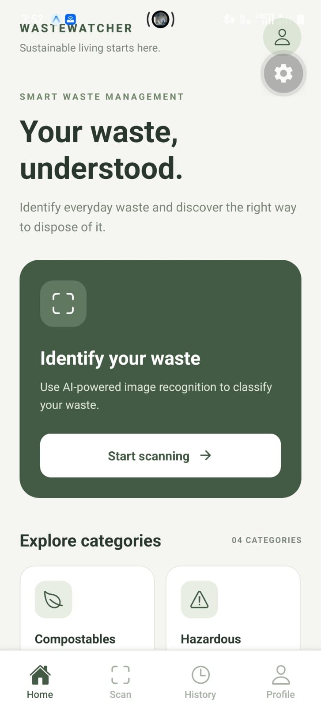
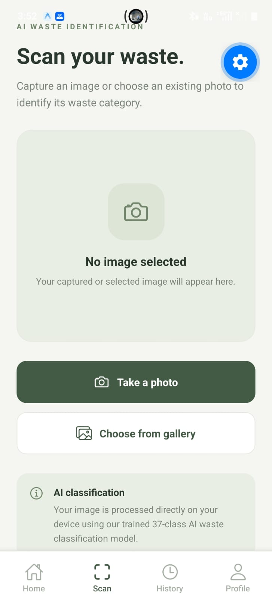
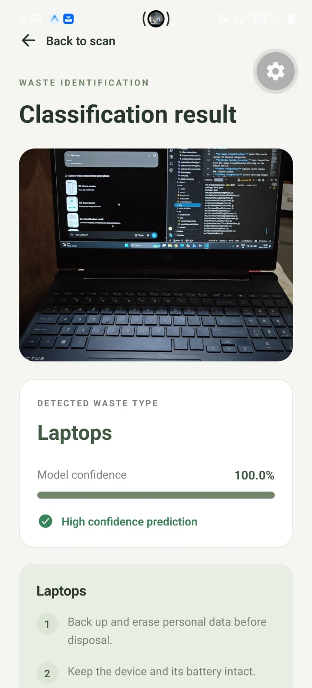
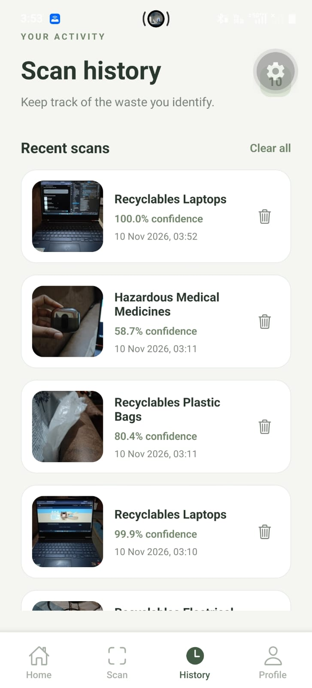
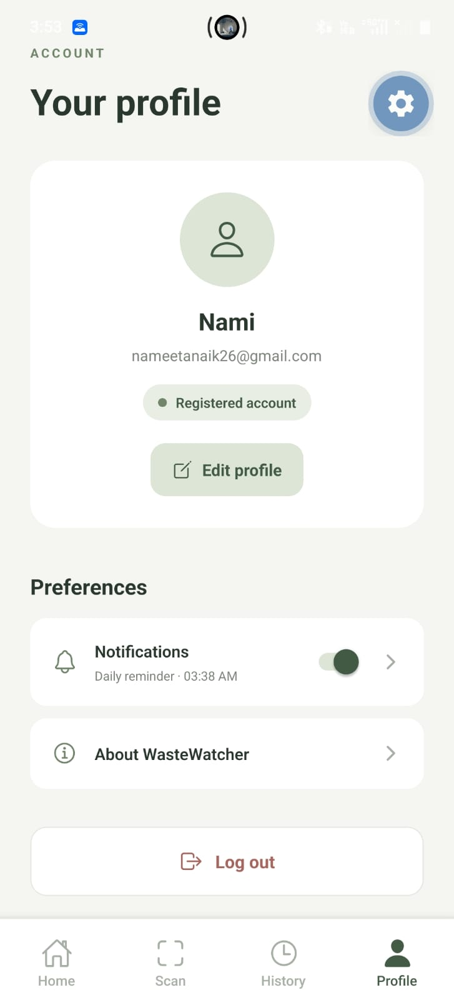
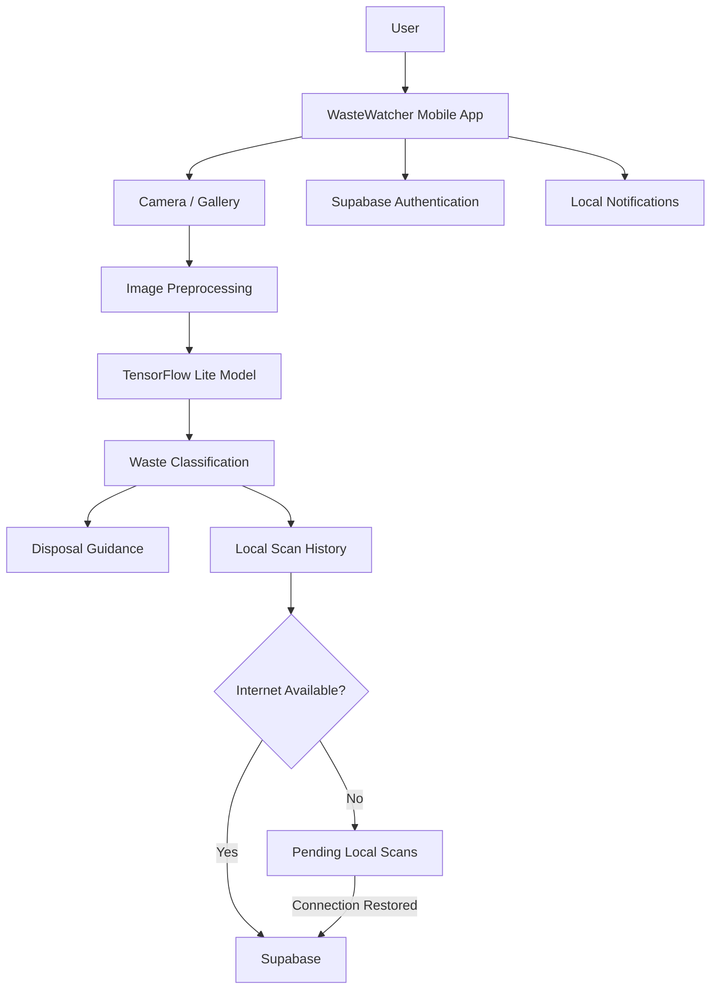

# WasteWatcher 

### AI-Powered Waste Classification and Smart Waste Management

WasteWatcher  is an AI-powered mobile application designed to make waste segregation easier and more accessible. It uses machine learning to identify different types of waste from images and provides appropriate disposal guidance.

The application combines on-device AI, mobile development, cloud storage, and offline synchronization to support smarter waste management.

## Features

- **AI Waste Classification:** Identifies waste across 37 trained categories.
- **On-Device Machine Learning:** Uses TensorFlow Lite for image classification directly on the mobile device.
- **Camera Integration:** Capture waste images for classification.
- **Gallery Integration:** Select existing images for classification.
- **Disposal Guidance:** Provides category-specific waste disposal recommendations.
- **Scan History:** Stores previous scans with images, timestamps, and confidence scores.
- **Cloud Synchronization:** Synchronizes scan history with Supabase.
- **Offline Support:** Saves scans locally when internet connectivity is unavailable and synchronizes them when connectivity returns.
- **User Authentication:** Supports account registration, login, and profile management.
- **Waste Segregation Reminders:** Provides configurable local notifications to encourage daily waste segregation.


## Application Screenshots

### Home Screen


### Waste Classification


### Classification Result


### Scan History


### User Profile



## System Architecture




## Technology Stack

| Category | Technologies |
|---|---|
| Mobile Development | React Native, JavaScript |
| Framework | Expo |
| Machine Learning | TensorFlow, TensorFlow Lite |
| Model Architecture | MobileNetV2 |
| Backend / Database | Supabase |
| Authentication | Supabase Auth |
| Cloud Storage | Supabase Storage |
| Local Storage | AsyncStorage, File System |
| Notifications | Expo Notifications |
| Navigation | React Navigation |
| Development | VS Code, Google Colab |

## AI Model

WasteWatcher uses a MobileNetV2-based image classification model trained to recognize 37 waste categories.

**Model details:**
- Architecture: MobileNetV2
- Input dimensions: 224 × 224 pixels
- Number of classes: 37
- Training framework: TensorFlow
- Mobile deployment: TensorFlow Lite
- Mobile model: Dynamic range quantized TFLite model

### Model Performance

| Metric | Result |
|---|---:|
| Test Accuracy (Float Model) | 80.35% |
| Weighted F1 Score | 80.69% |
| Macro F1 Score | 73.49% |
| Quantized Model Test Accuracy | 80.15% |

The model was evaluated on a held-out test dataset containing 2,524 images.

## Application Architecture

The application follows a mobile-first architecture:

1. **Presentation Layer:** React Native screens for home, scanning, results, history, authentication, and profile.
2. **AI Layer:** TensorFlow Lite performs waste image classification on-device.
3. **Data Layer:** Local storage maintains scan history and supports offline operation.
4. **Cloud Layer:** Supabase provides authentication, database services, and image storage.
5. **Notification Layer:** Expo Notifications manages scheduled waste segregation reminders.

## Offline Synchronization

WasteWatcher supports offline scanning.

When an internet connection is unavailable:
- Scan results are stored locally.
- Scan records remain available in the application.
- Pending scans are synchronized with Supabase when connectivity returns.

This helps maintain functionality even with intermittent internet access.

## Getting Started

### Prerequisites

- Node.js and npm
- Git
- Android development environment
- Expo development build
- Supabase project

### Installation

Clone the repository:

```bash
git clone https://github.com/nameetanaik-rgb/WasteWatcher.git
```

Navigate to the project directory:

```bash
cd WasteWatcher
```

Install dependencies:

```bash
npm install
```

### Environment Configuration

Create a `.env` file in the project root.

Add your own Supabase project credentials:

```env
EXPO_PUBLIC_SUPABASE_URL=YOUR_SUPABASE_URL
EXPO_PUBLIC_SUPABASE_PUBLISHABLE_KEY=YOUR_SUPABASE_PUBLISHABLE_KEY
```

Never commit your actual `.env` file or secret keys.

### Run the Application

Start the Expo development server:

```bash
npx expo start --dev-client
```

Open the application using a compatible installed development build.

**Note:** This application uses native modules, including TensorFlow Lite and Expo Camera. Expo Go alone is not sufficient. A compatible development build is required.

## Project Structure

```text
WasteWatcher/
│
├── assets/
│   └── models/
│       ├── class_names.json
│       └── wastewatcher_quantized.tflite
│
├── src/
│   ├── data/
│   │   ├── wasteCategories.js
│   │   └── wasteDisposalGuidance.js
│   │
│   ├── screens/
│   │   ├── auth/
│   │   ├── CameraScreen.js
│   │   ├── HistoryScreen.js
│   │   ├── HomeScreen.js
│   │   ├── ProfileScreen.js
│   │   ├── ResultsScreen.js
│   │   └── ScanScreen.js
│   │
│   ├── services/
│   │   ├── authService.js
│   │   ├── notificationService.js
│   │   ├── scanHistory.js
│   │   ├── supabase.js
│   │   └── wasteClassifier.js
│   │
│   └── theme/
│       └── colors.js
│
├── assets/
├── App.js
├── app.json
├── eas.json
├── package.json
└── README.md
```

## Future Improvements

- Improve classification accuracy and model generalization.
- Expand the waste classification dataset.
- Add multilingual support.
- Introduce more detailed recycling recommendations.
- Improve waste management analytics and insights.

## Project Information

**Project:** WasteWatcher 

**Domain:** Artificial Intelligence, Machine Learning, Mobile Application Development

**Platform:** Android and iOS

**Repository:** https://github.com/nameetanaik-rgb/WasteWatcher

---

Developed as an academic project focused on applying artificial intelligence to real-world waste management challenges.

